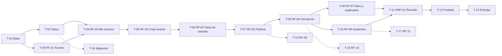

# Planificación

**Tarea 2 · Propuesta y planificación** · Autor y responsable de todas las tareas: **Oleksandr Rudynskyy** (trabajo individual)

- Estados posibles: **Pendiente**, **En curso**, **En revisión**, **Finalizada**.
- Estimaciones en horas de trabajo efectivo. Se añade un **20 % de margen** al total para imprevistos (riesgo R5).
- Una tarea solo pasa a **Finalizada** cuando se cumple su condición de cierre y está subida a la rama correspondiente.
- El estado se revisa cada viernes y se actualiza en este fichero (riesgo R6).

## Hitos

| Hito | Objetivo | Tareas | Horas | Se considera alcanzado cuando… |
|---|---|---|---|---|
| **H1 · Base técnica** | Proyecto nuevo funcionando en Docker, modelo de datos y acceso. | T-01, T-02, T-03 | 15 h | Se inicia sesión en la nueva aplicación y `php artisan migrate` crea todas las tablas. |
| **H2 · Gestión de eventos** | El organizador crea, configura y publica eventos. | T-04, T-05, T-06, T-07 | 20 h | Un evento creado desde la interfaz se ve en su página pública. |
| **H3 · Inscripción** | El público se inscribe sin duplicados ni sobreventa. | T-08, T-09 | 10 h | Se cumplen CA-06.x y CA-07.x. |
| **H4 · Asistentes, calidad y cierre** | Lista de asistentes, revisión de accesibilidad y pruebas. | T-10, T-11, T-12, T-13 | 13 h | Todos los criterios obligatorios están superados y documentados. |

**Total obligatorio:** 58 h + 20 % de margen ≈ **70 h**.

## Tareas del núcleo obligatorio

| Orden | Tarea | Requisito | Trabajo que debe realizarse | Hito | Depende de | Estimación | Responsable | Estado | Condición de cierre |
|---|---|---|---|---|---|---|---|---|---|
| 1 | T-01 | Base (todos) | Crear el proyecto Laravel + Inertia.js + React + TypeScript en contenedores Docker con MySQL, partiendo de las lecciones de la Tarea 1 (`.gitattributes`, `.env`, recreación de contenedores). | H1 | Tarea 1 | 6 h | O. Rudynskyy | Pendiente | La página inicial en React se ve en el navegador y `docker compose ps` muestra todos los servicios estables. |
| 2 | T-02 | Base (RF-02 a RF-08) | Migraciones y modelos: `users`, `events`, `ticket_types`, `registrations`, con claves foráneas e índice único `(event_id, email)`. | H1 | T-01 | 4 h | O. Rudynskyy | Pendiente | `php artisan migrate:fresh` termina sin errores y el índice único existe (`SHOW INDEX`). |
| 3 | T-03 | RF-01 | Inicio y cierre de sesión del organizador y protección de las rutas de gestión. | H1 | T-01 | 5 h | O. Rudynskyy | Pendiente | CA-01.1 a CA-01.5 superados. |
| 4 | T-04 | RF-02 | Pantalla «Mis eventos» (tabla en escritorio, tarjetas en móvil, estado vacío). | H2 | T-02, T-03 | 4 h | O. Rudynskyy | Pendiente | CA-02.1 a CA-02.3 superados. |
| 5 | T-05 | RF-03 | Formulario «Crear evento» con validación en cliente (ayuda) y en servidor (definitiva). | H2 | T-04 | 6 h | O. Rudynskyy | Pendiente | CA-03.1 a CA-03.5 superados. |
| 6 | T-06 | RF-04 | Alta de tipos de entrada dentro del evento y regla «suma de plazas ≤ aforo». | H2 | T-05 | 5 h | O. Rudynskyy | Pendiente | CA-04.1 a CA-04.3 superados. |
| 7 | T-07 | RF-05 | Acción «Publicar» con permisos por organizador y página pública del evento. | H2 | T-06 | 5 h | O. Rudynskyy | Pendiente | CA-05.1 a CA-05.4 superados. |
| 8 | T-08 | RF-06 | Formulario de inscripción, generación de referencia única y pantalla de confirmación. | H3 | T-07 | 6 h | O. Rudynskyy | Pendiente | CA-06.1 a CA-06.4 superados. |
| 9 | T-09 | RF-07 | Normalización del email, control de plazas dentro de una transacción con bloqueo y captura del error de índice único. | H3 | T-08 | 4 h | O. Rudynskyy | Pendiente | CA-07.1 a CA-07.4 superados (CA-07.4 con dos peticiones simultáneas). |
| 10 | T-10 | RF-08 | Lista de asistentes con búsqueda, paginación de 25 y política de acceso por organizador. | H4 | T-08, T-03 | 5 h | O. Rudynskyy | Pendiente | CA-08.1 a CA-08.4 superados. |
| 11 | T-11 | RNF-01 | Revisión de todas las pantallas a 360 px y solo con teclado; corrección de foco, etiquetas y mensajes de error. | H4 | T-04 a T-10 | 4 h | O. Rudynskyy | Pendiente | CA-R1.1 a CA-R1.3 superados y Lighthouse Accesibilidad ≥ 90 en P1–P5. |
| 12 | T-12 | Todos los obligatorios | Pasar todos los criterios de aceptación y registrar el resultado con fecha y captura. | H4 | T-11 | 3 h | O. Rudynskyy | Pendiente | Tabla de resultados completa, sin criterios obligatorios fallidos. |
| 13 | T-13 | Todos los obligatorios | Actualizar README (instalación, uso, decisiones), crear etiqueta de entrega y PDF de Aules. | H4 | T-12 | 1 h | O. Rudynskyy | Pendiente | Enlaces comprobados en ventana privada. |

## Tareas deseables y opcionales

Solo se empiezan cuando el hito H3 está terminado. Si falta tiempo, pasan a «fuera de alcance» sin afectar al recorrido principal.

| Orden | Tarea | Requisito | Trabajo | Depende de | Estimación | Responsable | Estado | Condición de cierre |
|---|---|---|---|---|---|---|---|---|
| 14 | T-14 | RF-09 (deseable) | Edición de evento y tipos con la regla «no bajar de los inscritos». | T-07 | 3 h | O. Rudynskyy | Pendiente | CA-09.1 superado. |
| 15 | T-15 | RF-10 (deseable) | Correo de confirmación enviado mediante la cola y el worker. | T-08 | 4 h | O. Rudynskyy | Pendiente | CA-10.1 superado. |
| 16 | T-16 | Datos (deseable) | Script de migración desde la base de datos de Attendize v2.8.0 según `04-arquitectura-y-datos.pdf`, con copia de seguridad previa e informe de rechazados. | T-02 | 5 h | O. Rudynskyy | Pendiente | Recuentos antes/después coinciden con el informe y la copia se restaura correctamente. |
| 17 | T-17 | RF-11 (opcional) | Check-in en el acceso. | T-10 | 4 h | O. Rudynskyy | Pendiente | CA-11.1 superado. |

## Dependencias

Las flechas discontinuas son tareas deseables u opcionales.

## Seguimiento

| Fecha de revisión | Tareas actualizadas | Observaciones |
|---|---|---|
| 28/10/2026 | — | Planificación inicial. Todas las tareas en estado Pendiente. |
